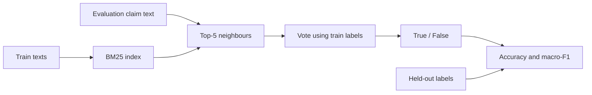

# B0: FactKG claim-only BM25-kNN

Простой CPU baseline для текущего benchmark FactKG. Предыдущий MetaQA prototype сохранён
как резерв, но не является основным B0 протокола v2.

Индекс: 86 367 train claims. Tokenizer lowercases и извлекает `[a-z0-9]+`, удаляет
фиксированный список служебных слов; not/never сохраняются. BM25 k1=1.5, b=0.75,
query terms учитываются однократно. Top-5 claims голосуют train labels без весов.
Ничьи по score разрешаются порядком SHA256 claim; label tie=False, no hits=train majority.
Evaluation labels никогда не участвуют в retrieval/voting. Обучения нейросети, KG и LLM нет.
Это контроль классификации, не graph retrieval и не воспроизведение SimGRAG.



Запуск из корня репозитория на доверенных авторских pickle:

```bash
python scripts/run_factkg_baseline.py --data-dir data/factkg/data/factkg_unzip --limit 0 --output data/evaluation/factkg-b0-dev.json
```

`--limit 0` означает весь split, default=500 по SHA256 текста. `--split test` поддержан,
но test в данном запуске не использовался. Разрешается пересечение train/eval текстов,
но оно измеряется и выдаются дополнительные nonoverlap metrics. Нечёткие и семантические
дубликаты этим аудитом не исключены.

## Реальный запуск 05.11.2026

| Метод | Dev n | Accuracy | Macro-F1 |
|---|---:|---:|---:|
| B0 BM25-kNN | 13 266 | 55.2766% | 55.2649% |
| Train-majority (всегда False) | 13 266 | 51.5604% | 34.0197% |
| B0 без exact train/dev overlap | 13 265 | 55.2733% | 55.2616% |

Найден один exact overlap. Первые 500 dev ранее дали accuracy 55.8%; параметры после
этого не менялись. Полный прогон выполнен для фиксированных параметров; test не смотрели для tuning.
Воспроизводимость: [summary](../results/factkg-b0-dev-summary.json) содержит SHA256 исходных
файлов и исполняемого script, Python version, параметры, timing и метрики. Полный локальный
JSON содержит predictions и neighbor IDs; данные/labels не добавляются в Git.
Около 105 секунд end-to-end в данном окружении — наблюдение одного запуска, не performance guarantee.

Улучшение над majority показывает, что baseline использует текстовый сигнал. Оно ничего
не говорит о новизне proposed matching. Для этого главный contrast — E1 vs B3 на одном
candidate KG и с одним reader; оба пока не реализованы/не запущены.

Проверки нового script: сохранение negation, macro-F1 при imbalance, полностью неверные
ответы, отказ на пустом evaluation. Результаты 31 теста изолированной рабочей копии
относятся к её коду, а не к невыполненному графовому эксперименту.
