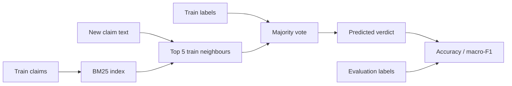
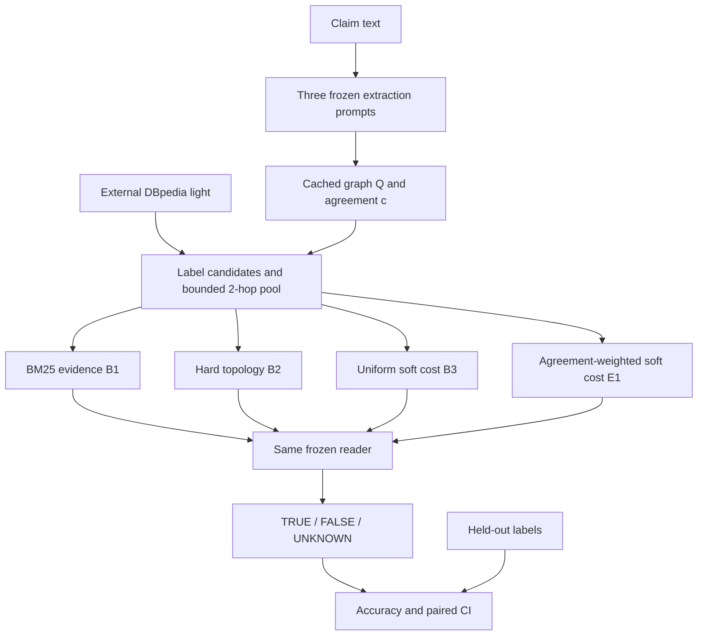

# E1: надёжность извлечённых связей при мягком сопоставлении графа документа и KG

Статус: исполнимый дизайн первого эксперимента, 05.11.2026. Тема — граф документа → KG.
Ядро расчёта стоимости mapping уже вынесено в `soft_isomorphism/matching.py` и покрыто тестами;
извлечение графа и построение candidate pool остаются отдельными слоями.
Новизна метода не доказана; гипотеза ниже подлежит проверке. Полный графовый эксперимент ещё не запускался.

## 1. Постановка, данные и границы вывода

Основной benchmark **FactKG**, второй **HotpotQA distractor**. MetaQA, GTSQA и Re-DocRED не входят в первый эксперимент.
В FactKG документом служит короткое утверждение, а целевым KG — авторский
`dbpedia_2015_undirected_light.pickle`. Это ограничивает выводы короткими документами;
результат нельзя переносить на длинные документы без отдельной проверки.
HotpotQA оценивает перенос retrieval в QA и общность бенчмарка с NGM-RAG;
он не является независимым тестом выравнивания документальных сущностей с Wikidata.

FactKG уже есть локально: 86 367 train / 13 266 dev / 9 041 test.
В train/dev есть `Evidence` (пути отношений), в test его нет.
`Entity_set`, `Evidence`, `Label`, `types` недоступны extractor и matcher в основном режиме.
Они находятся в evaluator; `Entity_set` разрешён только в отдельно обозначенном oracle-linking ablation.
DBpedia light ещё не скачан; нельзя строить ему замену из train/dev Evidence.
HotpotQA validation скачан: 7 405 записей. Есть текст, ответ, контексты и supporting facts; готового KG нет.

Re-DocRED исключён: проверены все 500 dev-документов — поля mentions содержат
name/type/positions, а не глобальные QID. PID отношения не заменяет entity linking.
Это исправляет прежнее утверждение о готовом сопоставлении Re-DocRED с Wikidata.

### Разбиения

- FactKG train: первые 500 по SHA256 UTF-8 claim — разработка extraction и ручной аудит ошибок.
- FactKG dev: первые 500 по тому же правилу — подбор параметров. Остальной dev — диагностика; он не называется окончательным test.
- FactKG test: первые 500 по SHA256 claim — первый фиксированный сравнительный эксперимент. Официальный полный test (9 041) — последующее масштабирование. Выборка не совпадает автоматически с SimGRAG.
- HotpotQA validation: сортировка по SHA256 исходного `id`; первые 200 — разработка, следующие 500 — локальная evaluation-выборка. Это разделение публичного dev, не официальный скрытый test и не известная выборка NGM-RAG.
- Записать IDs и SHA256 файлов до extraction. Ошибки/таймауты входят в знаменатель. Исключения определяются до результатов.

## 2. B0: действительно простой baseline

FactKG claim-only BM25-kNN: индексировать только train-утверждения; BM25 k1=1.5,
b=0.75; top-5 соседей голосуют train-метками. При отсутствии соседей — большинство train;
при равенстве — False. Negation tokens сохраняются. Никаких LLM/GNN/KG.
Выход `id, prediction, neighbor_ids, scores`; evaluator добавляет gold и считает
Accuracy и macro-F1. Проверяются exact train/eval duplicates, дополнительно выдаются
метрики без таких примеров. Это дешёвый контроль fact verification; преимущество над ним
само по себе не доказывает пользу graph matching.

Скрипт `scripts/run_factkg_baseline.py`, задача #13. Для научного вывода ниже необходимы
графовые контроли B1–B3 с одинаковыми входом, candidate pool и reader.

## 3. Как из документа получается граф

Модель фиксируем **Qwen/Qwen2.5-7B-Instruct**, локальный inference, greedy decoding,
temperature=0, max_new_tokens=1024, один и тот же checkpoint/precision во всех arms.
До запуска сохранить revision и SHA256 весов, tokenizer, runtime и prompt-файлов.
Не переключать модель между arms. Первый ресурсный замер — 50 train-примеров;
если модель не запускается, эксперимент считается заблокированным, замена требует новой версии протокола.
Платные API и обучение GNN не нужны.

Extractor получает только claim и список имён отношений из DBpedia light, без фактов KG.
Три детерминированных вызова отличаются инструкцией, а не temperature:

1. «Extract all explicitly asserted subject–relation–object facts from this text.»
2. «Read each clause and extract its asserted relations; do not add background knowledge.»
3. «Identify entities, then the relations actually asserted between them in this text.»

Общая часть prompt: «Use relation names from the supplied vocabulary, or unknown.
Preserve negation in polarity. Return JSON only: nodes[{id,label}],
edges[{source,relation,target,polarity,quote}]. quote must be an exact substring of the input.
Do not decide whether the claim is true. Do not invent missing facts.
Use a local variable node for an unspecified entity; mark its label as ?. Text: ...»

JSON валидируется: endpoints существуют, polarity ∈ {positive,negative}, quote — точная
подстрока исходного текста. Невалидный вызов даёт пустой граф без автоматических повторов.
Нормализация labels: Unicode NFKC, casefold, пробелы; никаких gold IDs.
Граф Q — объединение нормализованных троек трёх вызовов. Полярность входит в ключ ребра.
Надёжность c(e)=max(0.2,m(e)/3), где m — число вызовов, вернувших это ребро.
Это agreement score, **не калиброванная вероятность истинности**. Полностью пустой Q — failure.
Все методы получают один сохранённый Q. B3 получает все c=1; E1 — фактические c.

## 4. KG, linking и единый candidate pool

DBpedia light — внешняя база, полученная из официального FactKG ресурса. Обратное
`~r` нормализуется в прямое ребро с переставленными концами; дубликаты удаляются.
Labels сущностей — URI suffix, underscores заменены пробелами. Labels отношений аналогично.
Для каждого именованного узла Q найти top-5 KG entities по Jaccard множеств символьных
триграмм нормализованных labels (пустые строки дают similarity=0; одинаковые непустые=1).
Кандидаты нулевого сходства не добавляются. `?` получает переменные узлы из окрестностей якорей.

От объединения якорей построить окрестность радиуса 2 по обоим направлениям.
На шаге оставить не более 30 incident triples на вершину по BM25 текста тройки относительно
исходного claim; ничьи — по `(head,relation,tail)`. Максимум 2 000 уникальных рёбер,
обход breadth-first с лексикографическим порядком frontier. Это фиксированная эвристика,
а не гарантированно полный поиск. При пустом pool — failure, без добавления gold.
Для переменного узла оставить top-20 по числу соседей-якорей, затем KG ID.
Одинаковый pool используют B1/B2/B3/E1. Сохранить его для воспроизведения.

## 5. Сравниваемые методы и точный score

- **B0** — claim-only BM25-kNN, отдельный контроль классификации.
- **B1** — BM25 по candidate triples, top-20 evidence; этот arm проверяет пользу структуры.
- **B2** — полное инъективное отображение Q в candidate KG; каждое ребро Q обязано иметь
  направленное ребро между образами. Дополнительные KG-рёбра разрешены (non-induced matching).
  Labels ранжируются семантической стоимостью ниже. Это hard topology control, не репликация SimGRAG.
- **B3** — soft matching с одинаковыми весами рёбер c=1. Главный контроль научной гипотезы.
- **E1** — тот же soft matching с c(e)=agreement из extraction. Всё остальное идентично B3.

Отображение f: Vq → Vk ∪ {null}, инъективно на ненулевых образах; не менее
max(1,ceil(0.8|Vq|)) узлов должны иметь ненулевой образ. Для B2 все узлы ненулевые.

Node cost dV(v,f(v)) = 1 − trigram-Jaccard(label(v),label(f(v)));
dV(?,u)=0, dV(v,null)=0.8. Рёбра используют predicate labels: dR=1−token-Jaccard.
Если оба labels непустые и совпадают, dR=0; если один unknown/пустой, dR=1.
Для e=(u,r,v) определить:

    dE(e,f) = min(1, min over KG triples (f(u),s,f(v)) of dR(r,s))

Если endpoint=null или ребра между образами нет, dE=1. Направление сохраняется.
Отрицательная полярность не превращается в отсутствующее KG-ребро: matcher ищет факты
про то же отношение, а семантику отрицания обрабатывает reader.

    C(f) = 0.3 * sum(dV)/|Vq| + 0.7 * sum(c(e)*dE(e,f))/sum(c(e))

Для Q без рёбер C — только средняя node cost; такие случаи отмечаются отдельно.
**Не штрафуем все дополнительные KG-рёбра**: KG заведомо богаче документа.
Метод является asymmetric soft constraint matching, а не стандартным GED.

Решатель: beam search ширины 64; порядок query nodes — degree descending, затем local ID.
На шаге перебрать node candidates и null, отбросить нарушение инъективности/лимита null.
Оценивать уже назначенные node/edge terms с теми же полными знаменателями; остальные
terms=0 (нижняя оценка). Ничьи — лексикографическое представление f.
Ограничение 50 000 расширений; при исчерпании до полного mapping — failure.
Вернуть top-10 полных mapping. Approximate solver не гарантирует глобальный минимум.
На B2 использовать тот же enumeration budget, запрещая missing query edges.

Evidence — уникальные реальные KG-рёбра, выбранные при вычислении dE, из top mappings,
не более 20: сначала rank mapping, затем c(e) descending, затем triple IDs. Несуществующие
рёбра и null никогда не выдаются как факты. B1 тоже имеет budget 20.

## 6. Общий выход, reader и метрики

Reader для B1/B2/B3/E1 — тот же локальный Qwen checkpoint, greedy, max_new_tokens=128.
Prompt: «Given the claim and retrieved KG triples, return JSON {verdict: TRUE|FALSE|UNKNOWN}.
Use only the triples. Respect negation. Missing evidence alone is not proof of falsehood.
Claim: ... Evidence: ...». Только фактические retrieved triples, без c, названия метода и gold.
Выход reader парсится строго; UNKNOWN, invalid и retrieval failure считаются неверным
ответом при Accuracy (включая отрицательные claims). Abstention rate публикуется отдельно.
B0 сразу выдаёт verdict. Основная общая метрика — **FactKG Accuracy**; macro-F1 вторичная,
UNKNOWN/invalid даёт FN gold-классу и не получает отдельный усредняемый класс.

Primary contrast: E1 − B3 на исходных 500 test claims. Выигрыш над B0/VF2 недостаточен.
Paired bootstrap: 2 000 пересэмплирований claim IDs, seed=42, percentile 95% CI.
Положительный эффект: нижняя граница CI для ΔAccuracy >0; иначе поддержки гипотезы нет.
Latency p50/p95, failures, число ребёр, доля linked nodes и candidate budget — обязательны.
Измерять полное время и matching-only; extraction общий и кешированный, но его стоимость показывать.

FactKG Evidence не является готовым уникальным edge gold. На положительных dev-примерах
диагностически считать **path-constraint coverage**: долю аннотированных `(start entity,
relation sequence)` с реализующим путём в retrieved KG, соблюдая `~` и направления.
Это proxy: промежуточные сущности/конечные точки могут быть неоднозначны. Не называть его
edge F1, не использовать на test и не считать полноту совпадения доказанной.
Пустые аннотации отдельно, coverage только на заданном знаменателе непустых ограничений.

## 7. Проверка гипотезы и ablations

Не считать удаление ребра заведомо вредным exact matching: non-induced условия могут
стать слабее, а число совпадений — больше. Основной эксперимент — естественные ошибки extractor.
Диагностика на фиксированных 200 dev claims: deletion, insertion, relation substitution
и reversal **раздельно**, p∈{0,0.1,0.25,0.5}, seeds={17,42,73}.
Количество изменений floor(p*|Eq|); при нуле оставить запрос и учитывать это в отчёте.
Deletion сохраняет vertices. Insertion выбирает пару имеющихся разных узлов и случайное
отношение словаря; это synthetic edge, не гарантированно ложный факт.
Вес новых рёбер выбирается из эмпирических весов исходного Q независимо от того, был ли edge добавлен.
Не давать matcher метку corruption. Gold verdict остаётся от исходного документа;
reader получает исходный текст. Для всех методов одни и те же испорченные Q и pool,
построенный по исходному Q: это изолирует matcher. End-to-end потерю кандидатов исследовать отдельно.

Ablations: B3 (all c=1); E1 с переставленными c между рёбрами; E1 без структуры
(node cost only); oracle entity IDs (отдельно). Bootstrap группируется по исходному claim,
варианты/seed одного claim не считаются независимыми. Нельзя выбирать главный noise level после результатов.

## 8. Пример, который можно объяснить устно

Реальный train claim: «\"A Glastonbury Romance\" was followed by \"Weymouth Sands\" written by John Cowper Powys.»
В аннотации есть `A_Glastonbury_Romance —subsequentWork→ Weymouth_Sands` и
`Weymouth_Sands —author→ John_Cowper_Powys` (Evidence указывает эти пути в обе стороны).
Это проверено в локальном train; присутствие троек в скачанном DBpedia ещё не проверено.
Ожидаемый extraction Q содержит эти два утверждения; это иллюстрация, не результат вызова модели.
Если только один из трёх extractor outputs добавит `Romance —author→ Powys`, у него c=1/3.
E1 снизит влияние этого несогласованного ограничения относительно двух устойчивых рёбер.
Нельзя заранее говорить, что добавленная связь ложная: это устанавливает внешний KG/ручной аудит.
Если все три outputs повторят ошибку, agreement не поможет — это явный режим отказа гипотезы.

## 9. Второй benchmark: HotpotQA

На каждом примере KG строить из всех 10 предоставленных contexts, включая distractors,
тем же extractor; каждому ребру прикрепить `(title,sentence_id)` источника quote.
Сливать сущности только по нормализованному label; разные одинаковые имена могут ошибочно слиться,
это отдельная категория ошибок. Для QA строить Q из question тем же extractor с ? для неизвестного.
Использовать B1/B2/B3/E1 и одинаковый reader «Answer using only evidence; output short answer».
Метрики official answer EM/F1; retrieval supporting-fact P/R/F1 по provenance найденных triples.
Все contexts доступны методам, `supporting_facts` и `answer` только evaluator.
Это corpus-derived KG и query-graph matching. Он проверяет перенос механизма,
но не заменяет основной FactKG claim experiment и не является точной репликацией NGM-RAG.

## 10. Референс и научный статус

Основной референс **SimGRAG**: общий FactKG и retrieval перед верификацией. Наше проверяемое
отличие — мягкое отношение к topology mismatch с весами согласованности extraction.
B2 воспроизводит идею жёсткой структуры, но использует другой solver/labels/directions;
его нельзя подписывать SimGRAG. Авторский SimGRAG запускается отдельно в оригинальной
конфигурации только после resource audit. Paper accuracy — внешний ориентир, не наша контрольная группа.
Совпадение датасета само по себе не обеспечивает сопоставимость: нужны sample IDs, KG,
reader, extraction, метрики. Для component comparison всё фиксируем, кроме matcher;
для end-to-end comparison каждый метод сохраняет собственную архитектуру, но получает одинаковые
данные, доступные поля и оценщик; model/budget differences показываются явно.

**NeMa и GED уже решают noisy matching**, learned edit costs тоже известны.
Потенциальный вклад здесь — проверяемое применение agreement extraction как веса структурных
ограничений в документ→KG verification, с контролями uniform/shuffled weights и затратами.
Это кандидат на эмпирический вклад, не доказательство нового общего алгоритма.
Если E1 не превосходит B3 либо аналогичный pipeline уже опубликован, заявление о новизне снимается.
Руководителю можно показать этот дизайн даже при неподтверждённой новизне — его письмо это допускает.

### Что готово и что нужно для исполнения

Готовы: выбор двух наборов, локальный аудит, CPU baseline, конкретный алгоритм и схема оценки.
Для графового запуска остаются **DBpedia light и локальные веса Qwen**, extraction cache,
реализация B1/B2/B3/E1 и общего reader. Наличие дизайна не означает выполнение этих запусков.

Источники: [FactKG](https://github.com/jiho283/FactKG),
[SimGRAG, §4.2](https://aclanthology.org/2025.findings-acl.163.pdf),
[NeMa](https://sites.cs.ucsb.edu/~xyan/papers/vldb13_nema.pdf),
[learned edit costs](https://www.sciencedirect.com/science/article/pii/S0020025506000569),
[NGM-RAG](https://arxiv.org/pdf/2607.11159),
[HotpotQA](https://github.com/hotpotqa/hotpot).
