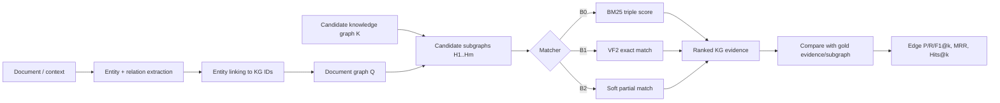

# План исследования: мягкое сопоставление графа документа с графом знаний

> Статус на 05.11.2026: направление подтверждено автором; выбор датасетов и гипотеза метода предварительные. Метрик пока нет. В рабочей папке локально найдены GTSQA и FactKG; MetaQA и HotpotQA пока отсутствуют. Для GTSQA проверена фактическая схема и два первых test-примера (см. «Локальная проверка данных» ниже).

## Что требуется закрыть по замечаниям руководителя

1. Сравнить существующие работы и сформулировать проверяемый knowledge gap.
2. Выбрать один простой baseline, который реально можно быстро запустить.
3. Описать первый эксперимент с предполагаемой новизной: входы, преобразования, алгоритмы, выходы и метрики.
4. Выбрать 1–2 датасета и проверить, что они действительно позволяют оценить заявленную задачу.
5. Обосновать релевантность сравнения с SimGRAG и NGM-RAG. Публикационные цифры сами по себе не являются head-to-head сравнением.

## Предварительный вывод по датасетам

| Набор | Что в нём есть | Что можно проверить | Ограничение для нашей темы |
|---|---|---|---|
| **GTSQA (уже есть локально)** | Вопросы, per-example candidate KG (`graph`), answer subgraph и Wikidata IDs. В test 1,622 записи; просмотренные два графа содержат 20,752 и 20,089 рёбер, gold subgraph — по 4 ребра. | Немедленный retrieval-пилот: ранжировать рёбра из candidate KG и сравнивать с gold answer subgraph; проверить устойчивость к неполному графу. | Вход — вопрос, не граф исходного документа. Это прямой graph retrieval по KG, но лишь proxy для выбранной темы; не эквивалент document graph matching. |
| **MetaQA** | Вопросы 1/2/3-hop, готовый movie KG в виде `subject|relation|object`, ответы и выделенная topic entity. SimGRAG запускает свой метод на MetaQA. | Недорогой пилот сопоставления графового шаблона вопроса с KG; sanity-check против SimGRAG при совпадении настроек. | Нет исходного документа и аннотированного графа документа. Граф вопроса надо строить парсером/шаблонами; это query-graph matching, а не прямой тест document-graph matching. |
| **HotpotQA** | Multi-hop вопросы, контексты из Wikipedia и sentence-level supporting facts; NGM-RAG использует 500 вопросов HotpotQA в distractor setting, строит графы через GPT-4o-mini, использует graph matching (LightGCN или GINE) и оценивает answer EM/F1. | QA/retrieval-пилот и сравнение покрытия supporting facts на фиксированной выборке. | Нет готового KG и ID отношений. Требуется построить графы из текста и отдельно определить источник candidate KG. Официальный датасет не ограничен схемой KG. |
| **Re-DocRED (кандидат для проверки соответствия теме)** | Документы с сущностями и отношениями, связанными с Wikidata; документальные графы ближе к выбранной постановке. | Прямее проверяет извлечение/сопоставление графа документа, чем QA-наборы. | Потребуется проверить доступность и лицензию конкретных файлов, соответствие ID, и как получить candidate KG без утечки эталонных троек. |

Источники: [MetaQA README](https://github.com/yuyuz/MetaQA), [SimGRAG paper](https://openreview.net/pdf?id=d84FoOidyN), [SimGRAG code](https://github.com/YZ-Cai/SimGRAG), [HotpotQA repository](https://github.com/hotpotqa/hotpot), [HotpotQA paper](https://arxiv.org/abs/1809.09600), [Re-DocRED paper](https://arxiv.org/abs/2205.12696).

### Рабочее решение

- **GTSQA — первый технический pilot, данные уже доступны локально**: в test есть candidate KG и отдельный gold answer subgraph. Это позволяет начать оценивать retrieval без ожидания загрузки новых наборов, но вопрос вместо document graph делает его proxy-проверкой.
- **MetaQA — следующий совместимый с SimGRAG пилот**: готовый KG и официальный split. Он проверяет графовый query matching, но не document graph matching. Файлов MetaQA пока нет.
- **HotpotQA — benchmark для сопоставимости с NGM-RAG по рекомендации руководителя**: он нужен для сопоставимости по бенчмарку с NGM-RAG. Сначала сделать feasibility spike: определить не использующий gold способ построения графа документа и candidate KG. Если честный protocol не получается за ограниченное время, не заявлять HotpotQA как прямую оценку soft graph matching.
- **Re-DocRED — кандидат на основной прямой тест темы**. До загрузки файлов и проверки лицензии это не выбранный датасет. Если Re-DocRED допустим, пара для собственно matching может стать MetaQA (контрольный KG query graph) + Re-DocRED (document graph). HotpotQA останется внешней QA-проверкой, а не третьим основным набором.

Таким образом, руководителю следует показать две отдельные оси: (A) сопоставимость с работами на общих QA-бенчмарках; (B) валидность целевой постановки «граф документа → KG». Нельзя подменять одну другой.

## Локальная проверка данных (05.11.2026)

В рабочем дереве обнаружены локальные файлы GTSQA (Parquet) и FactKG (pickle, около 31 MB). Файлы GTSQA не перечислены в Git и занимают около 13 GB в общей сложности. Через PyArrow прочитана схема test Parquet: 1,622 строки, 23 row groups; поля включают `question`, `graph`, `full_answer_subgraph_wikikg2` и `answer_node`. В двух первых строках `graph` содержит соответственно 20,752 и 20,089 рёбер, а gold answer subgraph — по 4 ребра. Форма графа — тройки с человекочитаемыми labels и QID/PID; gold хранится отдельно с идентификаторами. Это подтверждает техническую пригодность GTSQA для первого edge-retrieval пилота и одновременно подтверждает ограничение: текст входа — вопрос, не независимый документальный граф. Метрики качества ещё не вычислялись.

## Таблица работ и рабочий knowledge gap

| Работа | Вход → механизм → выход | Связь с экспериментом | Что не закрывает в нашей постановке |
|---|---|---|---|
| **SimGRAG** | Вопрос → LLM строит query graph → Graph Semantic Distance (GSD) ищет похожие подграфы KG → ответ | Главный алгоритмический ориентир; MetaQA — общий бенчмарк | Проверить в статье/code exact постановку GSD и возможную близость к нашей soft cost. Нет основания объявлять нашу идею новой до такого аудита. |
| **NGM-RAG** | LLM строит target graph из corpus и query graph из вопроса; node matching объединяет Levenshtein, BM25 и GNN score (LightGCN или GINE) адаптивными весами; top-5 узлов идут в ответ. На HotpotQA взяты 500 примеров distractor setting; auxiliary graph construction — GPT-4o-mini. | Сильный ориентир по graph construction + matching + answer generation; на общем HotpotQA сравнение уместно только при одинаковой выборке, контексте и evaluation. Paper сообщает answer EM/F1. | Полное воспроизведение включает graph construction, prompts, backbone, matching и generation. Только отдельный GNN не является reproduction NGM-RAG; без исходного кода/всех settings собственные числа нельзя напрямую сравнить с paper. |
| **SubgraphRAG / GFM-RAG** | Текстовый/структурный запрос → KG retrieval с learned структурными сигналами → candidate subgraph | Контекст для retrieval baselines и способов представления графа | Не считать прямым baseline без общего протокола и проверяемых входов/выходов. |
| **VF2 / exact matching** | Два графа → проверка точного изоморфизма / подграфового совпадения | Контрольный структурный baseline; быстро реализуется для малого пилота | Хрупок к пропущенным/лишним рёбрам и разным relation labels. |
| **Наш кандидат** | Граф документа → entity/relation linking → candidate KG subgraphs → частичное взвешенное соответствие с ценой пропусков/лишних рёбер → ranking | Проверяем, улучшает ли мягкость matching retrieval при неполных и шумных графах | Это пока гипотеза метода, а не установленная новизна. Сначала нужен обзор approximate subgraph matching, GSD и graph edit distance. |

**Предварительный knowledge gap:** для графа, извлечённого из документа, неясно, насколько полезно оценивать частичное структурное соответствие candidate KG subgraphs, когда часть документальных рёбер отсутствует или извлечена с шумом. Проверяемый вопрос: растёт ли edge Recall@k при контролируемом удалении/добавлении рёбер по сравнению с текстовым retrieval и строгим matching, при одинаковой генерации входного графа и одинаковом candidate pool?

Это рабочий вопрос, а не утверждение, что никто раньше этого не делал.

## Baseline B0 (первый запуск)

**BM25 по сериализованным KG-тройкам**, затем агрегация рангов троек в score сущности-ответа. Для каждого примера выдаём top-k ответов/троек; считаем Hits@1/5/10 и MRR для MetaQA. Это не graph matcher и не baseline для доказательства преимущества soft matching. Он нужен как простой нижний уровень. Реализация CLI для MetaQA подготовлена отдельно в draft PR #31; результатов по MetaQA пока нет, потому что файлов этого набора в окружении не найдено. Доступность GTSQA позволяет начать отдельный retrieval pilot на имеющихся файлах.

Дальше:

- **B1 VF2**: строгая структура на том же candidate graph и с теми же входными графами.
- **B2 SimGRAG**: запуск авторского кода только после проверки зависимостей, данных и входной конфигурации; иначе сравнить формализации/опубликованные результаты без заявления о прямом экспериментальном сравнении.
- **NGM-RAG**: условный репликационный baseline. Запускать только если доступен код и получается повторить оригинальную graph construction, GNN и evaluation. Иначе — related work и контекст на общем HotpotQA, не прямой baseline.

## Первый эксперимент с предполагаемой новизной

### Гипотеза

При фиксированных document graph, candidate KG и генераторе кандидатов частичное matching с явной ценой пропущенных и лишних рёбер сохраняет выше качество top-k retrieval при неполноте/шуме document graph, чем exact matching и текстовый baseline.

### Поток данных

### Алгоритм-кандидат

1. Один и тот же pipeline извлекает entities/relations для всех систем. На первом контролируемом пилоте использовать gold document graph там, где набор его предоставляет; отдельно измерить end-to-end вариант с predicted graph.
2. Для каждой пары узлов считать label/entity similarity; для каждой пары рёбер — relation compatibility и согласованность с отображением концов.
3. Разрешить частичное соответствие: добавить dummy/null узлы и рёбра с настраиваемыми штрафами за пропуски и лишние элементы; минимизировать нормированную суммарную цену. Подобрать параметры только на dev.
4. Для каждого candidate subgraph вернуть score и evidence edges. Оценить top-k против gold без передачи gold-информации matcher'у.
5. Провести ablation: только текстовый score; только структура; без penalty за лишние рёбра; без penalty за пропущенные; полный метод.
6. Выполнить corruption curve: удалить 0/10/25/50% входных рёбер и отдельно добавить distractor edges; построить качество от уровня corruption.

### Метрики

- **Retrieval:** edge Precision/Recall/F1@k, MRR и Hits@k.
- **QA downstream (MetaQA/HotpotQA):** answer EM/F1 только если downstream answering включён и одинаков для методов.
- **Надёжность графа:** доля примеров с корректно построенным query graph, доля успешно linked сущностей, coverage после candidate generation.
- Основной показатель для гипотезы — edge Recall@k при контролируемой потере рёбер; EM не заменяет графовую метрику.

## План выполнения

| Этап | Результат | Условие перехода |
|---|---|---|
| 1. Закрыть аудит метода | Сравнить формулы SimGRAG/GSD, NGM-RAG matching, approximate matching и graph edit distance; отметить точное отличие | Понятно, какие компоненты действительно новые |
| 2. Зафиксировать данные | Зафиксировать версии/checksum уже имеющихся GTSQA и FactKG; получить MetaQA; выбрать официальный HotpotQA dev distractor; проверить Re-DocRED как прямой graph-document кандидат | Установлены лицензии, поля, splits и protocol без утечки gold |
| 3. Запустить B0 | Метрики BM25 на MetaQA test, отдельно 1/2/3-hop | Есть сохранённые predictions, config и run metadata |
| 4. Сделать B1 | VF2 на тех же графах/candidates | Идентичные splits, candidate pool, метрики |
| 5. Feasibility HotpotQA | Без gold leakage построить document graph и candidate graph на малом pilot subset | Если невозможно, честно исключить прямое matching-сравнение на HotpotQA |
| 6. Реализовать B2 | Soft cost + ablations + corruption curve | Параметры выбраны на dev; один зафиксированный test |
| 7. Сравнить с работами | SimGRAG на MetaQA и NGM-RAG на HotpotQA только при репродуцируемых settings | Никакие опубликованные числа не представлены как собственный запуск |

### Ближайший конкретный шаг

Начать с уже имеющегося GTSQA test и зафиксировать метаданные локальных файлов; затем получить MetaQA (`kb.txt`, vanilla splits) для SimGRAG-сопоставимости и HotpotQA dev distractor для NGM-RAG-сопоставимости. Доступность файлов и запуск по конкретному набору фиксировать раздельно. MetaQA README описывает triple format, splits и объёмы; SimGRAG README подтверждает использование MetaQA, но точную конфигурацию и команду следует фиксировать по checkout репозитория. HotpotQA распространяется под CC BY-SA 4.0 и включает supporting facts, но не задаёт готовый KG. В NGM-RAG он используется в distractor setting на 500 вопросах с answer EM/F1; сам NGM-RAG строит target graph из корпуса и query graph из вопроса с GPT-4o-mini.
