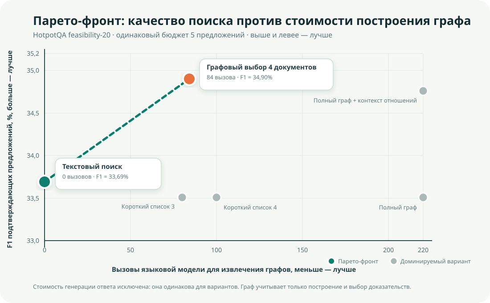

# Матрица источников НИР

Дата актуализации: **27.11.2026**  
Тема НИР: **мягкое сопоставление графа запроса/документа с графом знаний для графового поиска с дополненной генерацией**.

## 1. Как пользоваться матрицей

Матрица отвечает на четыре вопроса:

1. Какие методы уже решают близкую задачу?
2. Какие элементы нашего алгоритма уже встречаются в литературе?
3. На каких данных и по каким метрикам корректно сравниваться?
4. Какой исследовательский пробел остаётся после проведённых экспериментов?

Обозначения статуса источника:

- **A** — рецензированная публикация в материалах конференции или журнале;
- **B** — препринт, сведения и результаты ещё следует трактовать осторожно;
- **D** — первичная публикация набора данных.

## 2. Справочник методов

В следующих таблицах каждому методу присвоен код `M1`–`M16`. Код нужен
только для компактной матрицы; полное объяснение приведено здесь.

| Код | Метод | Что он делает | Вход → результат | Зачем применяется | Основное ограничение |
|---:|---|---|---|---|---|
| M1 | Построение графа запроса языковой моделью | Превращает вопрос или утверждение в вершины и подписанные рёбра. Например, из вопроса о месте рождения режиссёра получает цепочку «фильм → режиссёр → место рождения». | Текст запроса → небольшой граф-шаблон. | Делает требуемую цепочку отношений явной. | Модель может придумать неверное отношение или неправильную структуру. |
| M2 | Извлечение графа документов языковой моделью | Находит в тексте сущности, отношения и тройки, сохраняя связь с исходными предложениями. | Документы → граф сущностей и отношений. | Позволяет применять графовый поиск к обычному тексту. | Дорого по числу запросов и токенов; граф может быть неполным или фрагментированным. |
| M3 | Семантическое сравнение | Представляет названия вершин и отношений числовыми векторами и сравнивает их по смысловой близости. | Две подписи → числовая мера сходства или стоимости. | Сопоставляет перефразировки вроде «родился в» и «место рождения». | Похожие по словам отношения могут иметь разный смысл или направление. |
| M4 | Привязка вершин к кандидатам | Для каждой вершины запроса выбирает небольшое множество возможных объектов графа знаний или документов. | Вершина запроса + большой граф → список кандидатов. | Сокращает перебор и связывает упоминания с конкретными объектами. | Ошибка на этом этапе исключает правильный объект из дальнейшего поиска. |
| M5 | Точное структурное сопоставление | Требует, чтобы найденный подграф повторял число вершин, рёбер и их соединение в графе запроса. | Граф-шаблон + граф данных → изоморфный подграф. | Даёт строго согласованную и хорошо интерпретируемую структуру. | Не работает, если одно отношение в данных представлено несколькими рёбрами или промежуточной вершиной. |
| M6 | Соответствие ребра пути | Разрешает одному ребру запроса соответствовать пути из нескольких рёбер в графе данных. | Ребро запроса + граф → прямое ребро или короткий путь. | Переживает различия в детализации и схеме двух графов. | Длинные пути резко увеличивают поиск и могут давать случайные семантические совпадения. |
| M7 | Совместное согласование всего графа | Выбирает соответствия не для каждого ребра отдельно, а одно общее отображение, в котором общая вершина запроса означает один и тот же объект во всех путях. | Наборы кандидатов и путей → согласованное отображение. | Не позволяет двум частям ответа незаметно использовать разных людей или разные организации. | Комбинаторный перебор дорог; в наших абляциях отдельная польза этой операции пока не доказана. |
| M8 | Поиск связного подграфа | Возвращает связанные между собой факты, а не набор независимо похожих троек или фрагментов. | Оценённые вершины/факты → связный подграф. | Формирует цельную цепочку доказательства. | Связность сама по себе не гарантирует релевантность. |
| M9 | Ленивое построение графа | Не строит граф всего корпуса заранее, а раскрывает только область, связанную с текущим запросом. | Запрос + корпус → локальный граф под запрос. | Снижает объём графа и потенциальную стоимость обработки. | Если начальная область выбрана неверно, нужный документ никогда не попадёт в граф. |
| M10 | Нейронное сопоставление графов | Графовая нейронная сеть распространяет признаки по соседям и вычисляет структурную близость вершин или подграфов. | Два графа → нейронные оценки соответствий. | Учитывает контекст соседей, который не виден из одного названия. | Обычно требует обучения, вычислительных ресурсов и точного воспроизведения чужой модели. |
| M11 | Ограничения схемы и типов | Проверяет допустимость переходов по типам, например «человек → место рождения → город», используя отдельный граф схемы. | Кандидаты + граф типов → отфильтрованные кандидаты и допустимые расстояния. | Ускоряет поиск и отсекает структурно невозможные варианты. | Требует готовой и достаточно полной схемы, которой нет у произвольно извлечённого графа документов. |
| M12 | Многоуровневый граф или гиперграф | Одновременно представляет сущности, предложения, документы, обобщения либо многоместные отношения. | Текст → несколько связанных уровней представления. | Сохраняет информацию, которая теряется в простых бинарных тройках. | Усложняет построение, поиск и честное сравнение с простыми графами. |
| M13 | Исправление графа до поиска | Объединяет дубли, соединяет фрагменты или перестраивает граф до применения алгоритма поиска. | Фрагментированный граф → реорганизованный граф. | Борется с ошибками представления отдельно от самого сопоставления. | Исправление может добавить недоказанные связи или скрыть ошибку извлечения. |
| M14 | Сохранение происхождения факта | Для каждой вершины или тройки хранит исходный документ и предложение, из которого она извлечена. | Графовый факт → проверяемое исходное предложение. | Позволяет передавать генератору реальный текст и считать качество найденных предложений. | Происхождение подтверждает источник, но не истинность извлечённого отношения. |
| M15 | Поиск без обучения специальной модели | Использует готовые языковые и векторные модели, правила и алгоритмический поиск без обучения нового поисковика на целевом наборе. | Готовые модели + данные → результаты без этапа обучения. | Упрощает перенос, воспроизведение и запуск на малых данных. | Отсутствие обучения не означает низкую стоимость: вызовы большой языковой модели могут быть дорогими. |
| M16 | Условный запуск дорогого поиска | Сначала выполняет дешёвый поиск; дорогой графовый поиск запускается только при неуверенном результате. | Первый ответ + условие → завершение или второй поиск. | Экономит вычисления и не изменяет уже уверенные ответы первого этапа. | Уверенный, но ошибочный первый ответ не исправляется. |

## 3. Матрица «работа × метод»

Обозначения:

- **●** — метод является основной частью работы;
- **○** — метод используется частично, в изменённом виде или как
  вспомогательный компонент;
- **—** — метод не входит в опубликованный основной алгоритм;
- **н/д** — по доступному описанию нельзя сделать надёжный вывод.

Отметка **—** не означает, что авторы никогда не использовали похожую
операцию в коде. Она означает, что метод не заявлен как часть основного
алгоритма статьи.

### 3.1. Построение представления

| Работа | M1: граф запроса | M2: граф документов языковой моделью | M3: семантическое сравнение | M4: привязка вершин | M9: ленивое построение | M12: многоуровневый граф |
|---|:---:|:---:|:---:|:---:|:---:|:---:|
| SimGRAG (S1) | ● | — | ● | ● | — | — |
| SAFE (S2) | ● | — | ● | ● | — | — |
| MGRAG (S3) | ● | ● | ● | ● | ● | ● |
| NGM-RAG (S4) | ● | ● | ● | ● | ○ | — |
| SubgraphRAG (S5) | ○ | — | ● | ● | — | — |
| TopoRAG (S6) | — | — | ● | ● | — | — |
| HyperPathsRAG (S7) | ○ | ● | ● | ● | ○ | ● |
| FlowRAG (S8) | — | ● | ● | ● | — | ● |
| ReGraphRAG (S9) | — | ● | ● | ○ | — | ○ |
| G³RAG (S10) | — | — | ● | ● | — | ○ |
| **Наша текущая система** | **●** | **● на HotpotQA; — на FactKG** | **●** | **●** | **● на HotpotQA** | **—** |

### 3.2. Сопоставление и поиск

| Работа | M5: точная структура | M6: ребро → путь | M7: общее отображение | M8: связный подграф | M10: нейронное сопоставление | M11: схема и типы |
|---|:---:|:---:|:---:|:---:|:---:|:---:|
| SimGRAG (S1) | ● | — | ● | ● | — | — |
| SAFE (S2) | — | ● | ● | ● | — | ● |
| MGRAG (S3) | — | ● | ○ | ● | — | ○ |
| NGM-RAG (S4) | — | — | ○ | ○ | ● | — |
| SubgraphRAG (S5) | — | — | — | ○ | ● | — |
| TopoRAG (S6) | — | — | — | ● | — | — |
| HyperPathsRAG (S7) | — | ● | ● | ● | — | — |
| FlowRAG (S8) | — | ○ | — | ● | — | — |
| ReGraphRAG (S9) | — | — | — | ● | — | — |
| G³RAG (S10) | — | — | — | ○ | — | — |
| **Наша текущая система** | **—** | **●** | **●** | **●** | **—** | **—** |

Примечание к нашей строке: механизм общего отображения реализован, но его
отдельное преимущество над независимым поиском рёбер экспериментально не
подтверждено. Наличие метода в алгоритме и доказанная полезность метода —
разные утверждения.

### 3.3. Подготовка доказательств и стоимость

| Работа | M13: исправление графа | M14: происхождение до предложения | M15: без обучения поисковика | M16: условный дорогой поиск |
|---|:---:|:---:|:---:|:---:|
| SimGRAG (S1) | — | — | ● | — |
| SAFE (S2) | ○ | — | ● | — |
| MGRAG (S3) | — | ○ | ● | ○ |
| NGM-RAG (S4) | — | ○ | ○ | — |
| SubgraphRAG (S5) | — | — | — | — |
| TopoRAG (S6) | — | — | ● | — |
| HyperPathsRAG (S7) | — | ● | ○ | — |
| FlowRAG (S8) | — | ● | ● | — |
| ReGraphRAG (S9) | ● | ○ | ● | — |
| G³RAG (S10) | — | ● | ● | — |
| **Наша текущая система** | **—** | **●** | **●** | **●** |

### 3.4. Что видно из матрицы

1. Комбинация `M1 + M3 + M4 + M5 + M7` описывает основную идею SimGRAG.
2. SAFE заменяет точную структуру `M5` на соответствие ребра пути `M6` и
   добавляет схему `M11`.
3. MGRAG уже объединяет `M6` с ленивым построением `M9`, поэтому эта пара не
   может быть нашей широкой новизной.
4. Отличительная практическая комбинация нашей системы —
   `M6 + M7 + M14 + M16`: согласованный поиск коротких путей, возврат
   исходных предложений и запуск только после неуверенного первого ответа.
5. Из этой комбинации `M7` пока не имеет подтверждённого самостоятельного
   эффекта, а `M6` уже известен. Поэтому текущий положительный результат —
   инженерно-экспериментальный, а не доказательство нового класса
   сопоставления.
6. Следующая гипотеза должна исследовать проблему, которой нет в текущей
   матрице как уже занятой комбинации, либо давать новый формальный объект
   оценки. Кандидат — устойчивость к изменению гранулярности представления,
   но many-to-many matching (T2) запрещает называть новой саму идею
   «вершина → группа вершин».

## 4. Парето-фронт качества и стоимости

График построен только по вариантам одного эксперимента: первые 20 примеров
разработческой выборки HotpotQA, одинаковый бюджет из пяти предложений и одна
метрика качества — F1 подтверждающих предложений. Стоимостью считается число
вызовов языковой модели для извлечения графов. Вызовы генератора ответа не
учитываются, потому что их число и бюджет одинаковы.

| Вариант | Вызовы извлечения | Supporting F1 | Статус Парето | Почему |
|---|---:|---:|---|---|
| Текстовый поиск по предложениям | **0** | 33,69% | **На фронте** | Минимальная стоимость; ни один вариант с нулевой стоимостью не даёт большее качество. |
| Короткий список из 3 документов | 80 | 33,51% | Доминируется | Дороже и хуже текстового поиска. |
| Графовый выбор 4 документов | **84** | **34,90%** | **На фронте** | Лучшее качество среди проверенных вариантов и намного дешевле полного графа. |
| Короткий список из 4 документов | 100 | 33,51% | Доминируется | Графовый выбор четырёх документов одновременно дешевле и качественнее. |
| Полный граф всех 10 документов | 220 | 33,51% | Доминируется | Дороже текстового поиска и не лучше по качеству. |
| Полный граф + контекстное сравнение отношений | 220 | 34,76% | Доминируется | Графовый выбор четырёх документов использует меньше вызовов и получает F1 34,90%. |

В текущем наборе две недоминируемые точки. Текстовый поиск выбирается, когда
главное требование — минимальная стоимость. Графовый выбор четырёх документов
выбирается, когда допустимы 84 вызова ради прироста Supporting F1 на 1,21
процентного пункта.

Это локальный фронт выбора конфигурации, а не доказательство преимущества на
всей выборке. На последующей фиксированной выборке из 500 примеров прирост
Supporting F1 подтвердился (`37,71% → 40,78%`), но прирост Answer F1 не был
значимым (`62,77% → 63,06%`, `p=0,777`), а извлечение потребовало 2 230
вызовов и 1 781 453 токена. Поэтому по конечному качеству ответа и полной
стоимости графовый вариант пока нельзя считать практически оптимальным.

## 5. Ближайшие методы графового поиска

| № | Источник | Статус | Исследовательская задача | Представление и алгоритм | Данные и оценка | Основной вывод источника | Связь с нашей НИР | Что источник не позволяет заявлять |
|---:|---|:---:|---|---|---|---|---|---|
| S1 | [Cai et al. SimGRAG](https://aclanthology.org/2025.findings-acl.163/), 2025 | A | Как найти в графе знаний подграф, семантически соответствующий текстовому запросу? | Языковая модель строит граф-шаблон. Кандидат должен быть изоморфен шаблону; вершины и отношения сравниваются по расстояниям между векторными представлениями. | MetaQA, WebQSP, CWQ, FactKG; качество ответа и проверки фактов, время поиска. | Семантическое сравнение вершин и рёбер совместимо с эффективным поиском подграфов. | Исходная точка нашей темы и референс для FactKG. Наш метод ослабляет требование изоморфизма: одному ребру разрешено соответствовать пути. | Нельзя заявлять первое семантическое сопоставление графа запроса с графом знаний. |
| S2 | [Lee et al. SAFE](https://aclanthology.org/2025.emnlp-main.883/), 2025 | A | Как искать при ошибочной топологии графа, построенного языковой моделью? | Приближённое соединение по расстоянию: ребро запроса может соответствовать пути графа знаний ограниченной длины. Граф схемы используется как компактный указатель расстояний. | WebQSP, CWQ, GrailQA; точность и эффективность. | Ослабление «ребро → ребро» до «ребро → путь» повышает устойчивость и эффективность поиска. | Самый близкий алгоритмический аналог нашего сопоставления отношений с путями. У нас нет графа схемы, зато сохраняется происхождение фактов до предложений документов. | Нельзя заявлять первое сопоставление ребра запроса с путём графа знаний. |
| S3 | [Wang et al. MGRAG](https://doi.org/10.14778/3819518.3819565), 2026 | A | Как одновременно сократить построение графа, смягчить структурное сопоставление и повторно использовать вычисления генератора? | Граф строится лениво под запрос; отношение запроса сопоставляется с семантически агрегированным путём; применяется жадный поиск и кэширование состояний модели. | Семь мультимодальных наборов вопросов и ответов; качество и эффективность. | Ленивое построение графа и семантическое сопоставление путей могут работать в одной системе. | Ближайший концептуальный аналог: совпадают и выборочное построение графа, и поиск семантических путей. Наша постановка текстовая и использует фиксированный бюджет предложений. | Нельзя заявлять первое сочетание ленивого построения графа и семантического поиска путей. |
| S4 | [Chen et al. NGM-RAG](https://arxiv.org/abs/2607.11159), 2026 | B | Может ли нейронное сопоставление графов улучшить извлечение контекста для сложных запросов? | Граф запроса и граф корпуса сравниваются текстовым способом и графовой нейронной сетью; вклады способов адаптивно взвешиваются. | Многошаговые вопросы и длинные обобщения, включая HotpotQA; качество конечного ответа. | Сочетание текста и структуры графа превосходит ряд текстовых и графовых систем в условиях статьи. | Референс по HotpotQA и нейронный конкурент. Прямое численное сравнение возможно только на одинаковых примерах и с одинаковым генератором. | Нельзя называть NGM-RAG воспроизводимым прямым базовым алгоритмом без запуска его обучаемой части. |
| S5 | [Li et al. SubgraphRAG](https://arxiv.org/abs/2410.20724), 2025 | A | Нужен ли сложный последовательный поиск подграфа для вопросов к графу знаний? | Лёгкая нейронная модель параллельно оценивает тройки и учитывает направленные структурные расстояния; размер подграфа регулируется. | WebQSP и CWQ; качество ответа при разных генераторах. | Простой параллельный скоринг троек может быть сильным конкурентом сложному поиску. | Обосновывает обязательность простого контроля без совместного сопоставления графов. | Нельзя объяснять прирост только наличием сложного графового поиска без сравнения с независимым ранжированием фактов. |
| S6 | [Wu and Luo, TopoRAG](https://aclanthology.org/2026.findings-acl.1703/), 2026 | A | Как учитывать связность непосредственно при поиске ближайших объектов? | Приближённый поиск ближайших соседей ограничивает диаметр подграфа выбранных сущностей. Граф запроса явно не сопоставляется с графом знаний. | Графовые задачи поиска; точность, избыточность контекста и эффективность. | Связность можно контролировать без построения и сопоставления графа запроса. | Альтернативный структурный контроль для проверки, нужен ли именно наш граф запроса. | Нельзя приписывать любой эффект связности мягкому сопоставлению графов. |
| S7 | [Zhu et al. HyperPathsRAG](https://aclanthology.org/2026.findings-emnlp.1530/), 2026 | A | Как совместно находить полные многошаговые цепочки для сложного вопроса? | Вопрос разбивается на многоместные подвопросы, которые совместно сопоставляются с путями гиперграфа; оценивается полнота цепочки. | HotpotQA, 2WikiMultiHopQA и MuSiQue; точность ответа на сложных подвыборках. | Совместный поиск полной цепочки полезнее независимого поиска отдельных фрагментов. | Близкий референс по полноте цепочки, но представление и способ разложения отличаются от нашего бинарного графа. | Нельзя заявлять первый совместный поиск многошаговой цепочки на HotpotQA. |
| S8 | [Zhan et al. FlowRAG](https://aclanthology.org/2026.findings-acl.1050/), 2026 | A | Как объединить крупный и мелкий уровни текста и извлечь явную цепочку рассуждения? | Неоднородный граф содержит документы, обобщения, предложения и сущности; поиск использует активацию двух уровней и взвешенный поток. | Наборы сложных вопросов; качество поиска и ответа. | Многоуровневое представление повышает семантический охват и устойчивость пути. | Ключевой источник для будущей проверки устойчивости к разной гранулярности представления. | Нельзя заявлять первую систему, совместно использующую предложения, сущности и более крупные текстовые блоки. |
| S9 | [Kim et al. ReGraphRAG](https://aclanthology.org/2025.findings-emnlp.290/), 2025 | A | Что делать с фрагментированным графом, извлечённым из документов? | Перед поиском граф реорганизуется и расширяется дополнительными перспективами, затем результаты повторно ранжируются с учётом запроса. | Четыре набора; качество, разнообразие и абляции компонентов. | Разрыв связности можно исправлять преобразованием графа до поиска. | Альтернативный класс решений: не усложнять сопоставление, а сначала исправлять граф. | Нельзя считать сопоставление со связной группой вершин единственным способом борьбы с фрагментацией. |
| S10 | [Li et al. G³RAG](https://arxiv.org/abs/2609.19622), 2026 | B | Можно ли получить пользу графа без дорогого извлечения сущностей и отношений языковой моделью? | Геометрический граф документов, штраф плотности и ограниченное распространение релевантности на один шаг; построение не требует токенов языковой модели. | HotpotQA, 2WikiMultiHopQA, MuSiQue; качество ответа и стоимость. | Более дешёвая структура документов может давать прирост без извлечения графа языковой моделью. | Главный контроль стоимости после нашего результата: 2 230 вызовов модели не дали значимого прироста качества ответа на HotpotQA. | Нельзя утверждать, что дорогое извлечение графа необходимо для многошагового поиска. |

## 6. Теоретические источники по сопоставлению графов

| № | Источник | Статус | Что формализовано | Почему нужен в НИР | Ограничение относительно нашей задачи |
|---:|---|:---:|---|---|---|
| T1 | [Fan et al. Graph Homomorphism Revisited for Graph Matching](https://vldb.org/pvldb/vol3/R103.pdf), 2010 | A | Гомоморфизм с путями: ребро одного графа отображается в путь другого; учитывается сходство вершин. | Теоретический предшественник ослабления «ребро → путь». Показывает, что сама конструкция существовала до современных систем дополненной генерации. | Нет текстовой семантики, языковой модели, происхождения фактов и генерации ответа. |
| T2 | [Zaslavskiy et al. Many-to-Many Graph Matching](https://arxiv.org/abs/1004.4965), 2010 | A | Сопоставление кластеров вершин двух графов как дискретная оптимизация с непрерывным ослаблением. | Ограничивает новизну идеи «одна вершина соответствует группе вершин» и задаёт теоретический фон следующей гипотезы. | Рассматривает зрительные графы, а не извлечённые текстовые графы и поиск доказательств. |
| T3 | [Moustafa et al. Subgraph Pattern Matching over Uncertain Graphs](https://linqs.org/assets/resources/moustafa-icde14.pdf), 2014 | A | Поиск шаблона в вероятностном графе сущностей с неопределённостью идентичности, атрибутов и рёбер. | Показывает, что общий поиск в неопределённом графе не является новым; нужен при обсуждении ошибок извлечения. | Не проверяет устойчивость выбранных исходных предложений при преобразованиях текстового графа. |
| T4 | [Shao et al. Certified Robustness on Visual Graph Matching](https://openreview.net/pdf?id=zkzf0VkiNv), 2024 | A | Формальная область устойчивости нейронного сопоставления зрительных графов с помощью случайного сглаживания. | Методологическая граница нашей отклонённой гипотезы о сертификате устойчивости. | Другая модальность, другой тип возмущений и нет поиска текстовых доказательств. |
| T5 | [Xiang et al. RobustRAG](https://openreview.net/pdf?id=qsEeACAJjD), 2024 | A | Сертифицированная устойчивость генерации к внедрённым или испорченным текстовым фрагментам. | Не позволяет заявлять первую сертифицированную систему дополненной генерации; помогает точно описать отрицательный результат H14. | Сертифицирует ответ при повреждении документов, а не сопоставление извлечённых графов. |

## 7. Наборы данных и протокол оценки

| № | Источник | Статус | Содержание | Почему выбран | Что измеряем в нашей работе | Ограничение сравнения |
|---:|---|:---:|---|---|---|---|
| D1 | [Kim et al. FactKG](https://aclanthology.org/2023.acl-long.895/), 2023 | D | 108 тысяч утверждений для проверки по графу знаний; пять типов рассуждения: один переход, конъюнкция, существование, несколько переходов и отрицание. | Используется SimGRAG; позволяет отдельно проверить извлечение фактов и итоговый ответ «истина/ложь». | Accuracy, Macro-F1, число ответов «неизвестно», парные изменения правильности, покрытие путей. | Наши локальные 500 примеров не тождественны опубликованной выборке SimGRAG без совпадения идентификаторов и протокола. |
| D2 | [Yang et al. HotpotQA](https://aclanthology.org/D18-1259/), 2018 | D | Около 113 тысяч многошаговых вопросов по Википедии; размечены предложения, необходимые для ответа. | Используется NGM-RAG и множеством графовых методов; позволяет раздельно оценивать поиск доказательств и ответ. | Supporting precision/recall/F1, Answer EM/F1, парные перестановочные тесты, число вызовов и токенов. | Мы используем фиксированный срез distractor validation, а не официальный скрытый test; опубликованные числа нельзя считать прямым сравнением. |

## 8. Обзоры и источники для позиционирования

| № | Источник | Статус | Назначение в НИР | Как используется |
|---:|---|:---:|---|---|
| R1 | [Edge et al. From Local to Global: A Graph RAG Approach](https://arxiv.org/abs/2404.16130), 2024 | B | Базовая мотивация графового представления и отличие локальных и глобальных вопросов. | Введение и объяснение места графового поиска среди методов дополненной генерации. |
| R2 | [Zhang et al. Graph Retrieval-Augmented Generation: A Survey](https://arxiv.org/abs/2501.13958), 2025 | B | Таксономия построения графа, поиска и генерации; перечень задач и открытых проблем. | Структура обзора литературы и проверка полноты классов методов. Не используется как доказательство результата конкретного алгоритма. |

## 9. Матрица исследовательских утверждений

| Утверждение | Источники, которые его поддерживают | Источники или наши результаты, которые его ограничивают | Итог для НИР |
|---|---|---|---|
| Семантическое сопоставление графа запроса полезно для поиска в графе знаний. | S1, S2, S3, S4 | S5 показывает силу простого скоринга фактов. | Использовать графовое сопоставление можно, но нужен простой контроль с тем же бюджетом фактов. |
| Ребро запроса может соответствовать пути графа знаний. | S2, S3, T1 | Это уже известная идея; наш HotpotQA-эксперимент улучшил поиск доказательств, но не конечный ответ. | Это компонент метода, а не самостоятельная новизна НИР. |
| Связность найденных фактов важна. | S2, S6, S7, S8 | В нашем контроле преимущество общего совместного отображения над независимым поиском рёбер не подтверждено. | Нельзя приписывать эффект именно совместному сопоставлению без отдельной абляции. |
| Ленивое построение графа уменьшает лишнюю работу. | S3 | S10 показывает, что извлечения графа языковой моделью можно вообще избежать. | Стоимость должна быть основной метрикой наряду с качеством. |
| Фрагментацию представления лучше обрабатывать сопоставлением вершины с группой вершин. | T2 даёт общую формализацию; S8 показывает пользу нескольких уровней. | S9 исправляет фрагментацию до поиска; общий many-to-many механизм не нов. | Допустима только узкая гипотеза об устойчивости к контролируемому изменению гранулярности. |
| Устойчивость результата к удалению элемента графа указывает на правильность. | T3–T5 мотивируют изучение устойчивости. | Наш пилот H14: покрытие 14%, Supporting F1 сертифицированной группы 0,2460 против 0,4168 у остальных. | Гипотеза опровергнута для удаления одной извлечённой тройки; направление не расширять. |
| Улучшение поиска доказательств улучшит ответ. | D2 позволяет проверить обе части. | На наших 500 HotpotQA Supporting F1 вырос на 3,06 п.п., Answer F1 — только на 0,29 п.п. с p=0,777. | Нужны раздельные утверждения о поиске и генерации; перенос между ними не доказан. |

## 10. Итоговый исследовательский пробел

После учёта S1–S10 нельзя заявлять новизной:

- мягкое семантическое сопоставление графов вообще;
- соответствие ребра запроса пути графа знаний;
- ленивое построение графа под запрос;
- сопоставление одной вершины с группой вершин в общем виде;
- первый графовый многошаговый поиск на HotpotQA.

Остаётся проверяемый, но пока не подтверждённый вопрос:

> Может ли ограниченное сопоставление вершины запроса со связной группой
> вершин документа сохранять правильные исходные предложения при
> контролируемом разделении, объединении и превращении отношений в
> промежуточные вершины лучше, чем сопоставление «вершина → вершина», поиск
> путей и предварительное объединение упоминаний, при одинаковом бюджете
> доказательств?

Потенциальный вклад здесь состоит не в изобретении many-to-many matching, а
в формализации **сдвига гранулярности текстового графа**, воспроизводимом
наборе преобразований, равных контролях и экспериментальном ответе на вопрос
об устойчивости. До литературной проверки точного алгоритма и положительного
контрольного эксперимента это следует называть кандидатом на гипотезу, а не
доказанной новизной.

## 11. Минимальный обязательный набор для текста НИР

Если объём обзора ограничен, в основной текст должны войти:

1. **SimGRAG (S1)** — ближайшая исходная работа по семантическому
   сопоставлению графа запроса.
2. **SAFE (S2)** — прямой предшественник соответствия «ребро → путь».
3. **MGRAG (S3)** — ближайшая комбинация ленивого построения графа и
   семантического поиска путей.
4. **NGM-RAG (S4)** — нейронная альтернатива и референс по HotpotQA.
5. **SubgraphRAG (S5)** или **TopoRAG (S6)** — простой сильный структурный
   контроль.
6. **Many-to-Many Graph Matching (T2)** — граница новизны следующей идеи.
7. **FactKG (D1)** и **HotpotQA (D2)** — первичные описания использованных
   данных и метрик.

Остальные источники нужны для подробного обзора, объяснения отрицательных
результатов и проверки следующей гипотезы.
