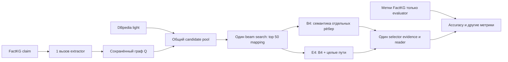

# E4: проверка связности доказательств при мягком сопоставлении с KG

Статус: **дизайн следующей гипотезы, результат не получен**. Дата 13.11.2026.
Предыдущий E1 с весами из согласованности извлечений закрыт: в однопроходном
режиме он тождественен B3 ([доказательство](https://github.com/OlegYurchik/soft-isomorphism/blob/exp/issue-19-factkg-pilot/docs/e1-degeneracy-proof.md)).

## 1. Проверяемая гипотеза и граница новизны

**H4:** при одном сохранённом извлечении графа, общем KG candidate pool,
одинаковом семантическом score для отдельных отношений и одном reader
ранжирование отображений с явным штрафом за незавершённые пути длиной 2–3
повысит Accuracy на FactKG claims, где извлечённый граф содержит хотя бы
два ребра, относительно ранжирования только по отдельным рёбрам.

Это *эмпирическая гипотеза о конкретном штрафе и контроле*. [SimGRAG](https://aclanthology.org/2025.findings-acl.163/)
уже использует семантическое сравнение графа и жёсткое структурное
соответствие; [EARL](https://arxiv.org/abs/1801.03825) уже совместно связывает
сущности и отношения; [FactGenius](https://aclanthology.org/2024.fever-1.30/)
уже ищет fuzzy отношения на FactKG; [Fact or Fiction?](https://arxiv.org/abs/2408.07453)
показывает силу простой 1-hop окрестности. Мы **не** заявляем новизной
семантическое relation linking, графовый retrieval, мягкий штраф или поиск
альтернативных фактов. Проверяем только, даёт ли дополнительная награда за
целые короткие пути эффект при фиксированном бюджете. Глобальная новизна
такого сочетания ещё не доказана.

## 2. Входы и заморозка

- Основной benchmark: FactKG, авторский DBpedia 2015 light. Из текста claim
  Qwen3.8-27B извлекает один JSON-граф `Q=(V,E)`; промпт и параметры такие
  же, как в [пилоте #19](https://github.com/OlegYurchik/soft-isomorphism/blob/exp/issue-19-factkg-pilot/docs/factkg-e1-pilot.md).
  Извлечённый граф кэшируется **один раз** и используется всеми arm.
- Для каждого именованного узла Q строится один общий список до 5 KG IDs:
  exact ID, затем FTS trigram. Переменная `?` берётся из окрестностей якорей.
  Общий candidate pool: radius 2, до 30 incident triples на шаг, максимум
  2 000 KG triples. Он сохраняется до сравнения arm. Метки FactKG,
  `Entity_set`, `Evidence`, `types` недоступны extractor, linker и matcher.
- Семантический encoder отношений: замороженный
  [`sentence-transformers/all-MiniLM-L6-v2`](https://huggingface.co/sentence-transformers/all-MiniLM-L6-v2),
  без дообучения. До запуска записать commit модели, SHA-256 файлов и
  версию runtime; во всех arm один кэш embedding. Строки KG predicates
  разделяются по CamelCase/underscore; `~r` разворачивается в обратное
  направленное ребро до matching. Никакого дополнительного LLM-вызова для
  relation linking нет.

## 3. Алгоритм E4 без неопределённых шагов

1. Запустить существующий B3 beam search шириной 64 с лимитом 50 000
   расширений, сохранить **top 50 полных отображений** `f: V_Q→V_KG∪{null}`.
   Если их меньше, использовать все; если нет ни одного — `failure` в
   знаменателе всех arm. Один и тот же top 50 получают B4 и E4. Так
   гипотеза проверяет только re-ranking, а не генерацию кандидатов.
2. Для query relation `r` и KG predicate `p` вычислить нормированные
   embeddings `u(r),u(p)` и `s(r,p)=max(0,cos(u(r),u(p)))`.
   При сравнении `r` с тройками между `f(source)` и `f(target)` выбрать
   наибольшее `s`; если ребра с нужным направлением нет, `d_e(f)=1`, иначе
   `d_e(f)=1−max s`. Нулевые/null endpoints тоже дают 1. Одно и то же
   расстояние используется B4 и E4; семантические alias не придумываются.
3. Задать `C_B4(f)=0.3·mean_node_distance(f)+0.7·mean_e d_e(f)`.
   Node distance и правило ≥80% ненулевых узлов наследуются от B3.
   При пустом Q обе ветви возвращают failure.
4. Перечислить все *направленные простые* query paths `Π` длиной 2 или 3,
   без повторных вершин. Путь считается завершённым для `f`, если каждый
   его query edge имеет реальную KG-тройку между отображёнными endpoints
   с `s≥0.55`. Положить `P(f)=1−(# завершённых путей)/|Π|`; при пустом
   `Π` определить `P(f)=0`. Тогда `C_E4(f)=C_B4(f)+0.2·P(f)`.
   Веса 0.3/0.7, порог 0.55 и коэффициент 0.2 фиксируются **до** просмотра
   новых dev/test результатов; не подбираются по gold.
5. В каждой arm выбрать отображение с минимальным score, ничьи — по
   лексикографическому tuple KG IDs. Для каждого query edge взять его
   лучшую настоящую KG-тройку только если `s≥0.55`; сначала упорядочить
   тройки завершённых путей, затем остальные, убрать дубли и оставить
   максимум 20. **Один и тот же selector** используется в B4/E4.
   Никаких «доказательств» из отсутствующих KG-рёбер. Reader получает
   claim и этот список; возвращает TRUE/FALSE/UNKNOWN.

Пример из постановки FactKG: «AIDAstella was built by a company in
Papenburg». Q содержит `AIDAstella → ? → Papenburg`. Если KG содержит
`AIDAstella —shipBuilder→ Meyer_Werft` и
`Meyer_Werft —location→ Papenburg`, E4 предпочитает mapping, сохраняющий
**оба** шага; B4 рассматривает среднюю стоимость шагов без отдельного
бонуса за целый путь. Если LLM извлёк неверный путь или нужного факта нет
в candidate pool, E4 не может его восстановить — такой отказ остаётся в
метриках.

## 4. Контроли и причинный контраст

| Arm | Что меняется относительно E4 | Что проверяет |
|---|---|---|
| B0 | Claim-only BM25-kNN, уже реализован | Дешёвый неграфовый ориентир; не главный causal contrast |
| B1 | Top-20 BM25 triples из 1-hop окрестности общих якорей в том же pool, тот же reader | Не превосходит ли простой широкий retrieval сложный matching |
| B3 | Текущий lexical soft matcher, один Q и тот же pool | Эффект всей новой семантической части, не вклад path penalty |
| **B4** | Те же top-50, encoder, `d_e`, evidence selector и reader, но `P(f)=0` | **Главный контроль:** эффект только штрафа за незавершённые пути |
| **E4** | B4 плюс `0.2·P(f)` | Проверяемая гипотеза |

SimGRAG и FactGenius — внешние референсы на FactKG, но их опубликованные
Accuracy нельзя складывать в эту таблицу: модели, sample IDs, число LLM
вызовов и права доступа к `Entity_set` могут различаться. NGM-RAG остаётся
related work по HotpotQA и не является контрольной группой FactKG.

## 5. Выборки, метрики и правило решения

- Engineering: первые 100 train claims по SHA-256. Dev: первые 500 dev
  для обнаружения ошибок реализации; параметры выше не менять по меткам.
  Ранее просмотренные первые 20 dev/test не используются как независимая
  проверка. Для retrieval диагностики взять **dev ranks 500–999**, которые
  не использовались в пилоте; заранее сохранить IDs.
- Финальная локальная проверка: **test ranks 20–519** по SHA-256 текста,
  чтобы исключить ранее просмотренные test-20. Это новый фиксированный
  test subset из 500; не официальный полный FactKG test и не sample
  SimGRAG. B0 для этих же IDs пересчитать из того же train.
- Primary population: claims этого test subset с `|E_Q|≥2`, определённые
  по замороженному extractor **до оценки меток**. Primary metric —
  Accuracy E4−B4, UNKNOWN/invalid/failure считаются ошибкой. Публиковать
  также Accuracy на всех 500, число eligible claims и разрез по типам
  FactKG только в evaluator. Reader одинаковой модели/версии, prompt,
  температуры и лимита tokens для всех arm; кэш по `(claim,evidence)`.
- Paired bootstrap 2 000 пересэмплирований eligible claim IDs, seed=42,
  percentile 95% CI. **Поддержка H4:** нижняя граница CI для разницы
  Accuracy >0. **Отрицательное практическое решение:** point estimate ≤0
  или retrieval не улучшился на dev holdout. Иначе результат
  «неопределённый», без заявления об улучшении. Если eligible claims <100,
  не делать вывод по test-500 и заранее перейти к большему test subset.
- Retrieval gate без reader: на положительных dev ranks 500–999 с
  непустым авторским `Evidence` считать path-constraint recall — долю
  аннотированных `(start entity, relation sequence)`, для которых
  отправленные reader реальные KG-тройки содержат соответствующий
  направленный путь (`~r` интерпретировать как инверсию). Это **proxy**,
  поскольку аннотация не задаёт единственный edge gold. Дополнительно
  вручную проверить 50 фиксированных claim IDs с новыми evidence на
  релевантность, не используя эту оценку для подбора порога.
- Обязательные диагностические метрики: доля непустых evidence,
  UNKNOWN, число завершённых query paths, ложные/нерелевантные evidence
  в аудите, mapping changes E4/B4, latency p50/p95 и число KG triples,
  попавших в reader. Если Q или pool пуст, ошибка входит в denominator.

## 6. Исполнимость и ограничения

Первые два шага используют существующие извлечение, linking, bounded pool
и beam search. Новые компоненты — кэшированное кодирование **уникальных**
relation strings, re-ranking top-50 и path/evidence selector. Для короткого
Q число простых путей длины ≤3 мало; GNN и обучение не требуются. Сначала
запускается retrieval gate без доступности ИТМО reader. Если encoder или
API-reader недоступен, соответствующий этап остаётся незавершённым, а не
заменяется числами другого метода. Результаты пилота 20 claims не служат
оценкой E4. Научная новизна возможна только после проверки H4 против B4,
B1 и анализа внешних аналогов; сейчас она **не заявляется**.
